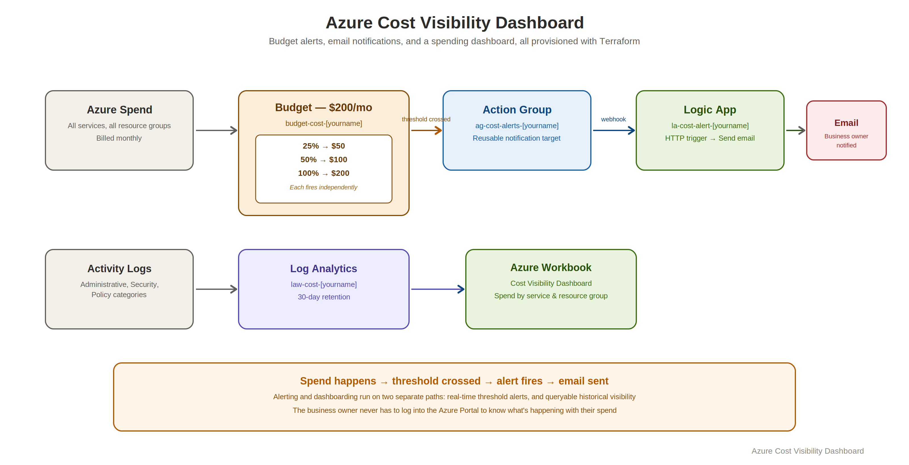

# Azure Cost Visibility Dashboard

A cost tracking and alerting system built with Terraform: automatic budget alerts at $50, $100, and $200, email notifications via Logic Apps, and a spending dashboard in Azure Workbooks, giving a business owner real-time visibility into their Azure spend without having to read a billing statement.


## 🎥 Watch Me Live
[Watch me build this lab live →](PASTE_YOUR_LINK_HERE)

## Overview

| Field | Value |
|---|---|
| Time to complete | 3 to 4 hours |
| Difficulty | Beginner |
| Tools used | Terraform, Azure CLI, Azure Monitor, Logic Apps, Azure Workbooks |
| Career relevance | Cloud Cost Management, FinOps, Azure Administration, Cloud Operations |

## The Business Problem This Lab Solves

Most small businesses move to the cloud because someone told them it would be cheaper than managing their own servers. Then the bills start arriving, full of line items like `Microsoft.Compute/virtualMachines — $340` that nobody in the business can interpret, predict, or explain to anyone else.

This lab builds a system that tracks spending across all Azure services and translates it into categories a business owner can actually read, fires automatic alerts when spending hits defined thresholds, sends email notifications the moment that happens, and displays a dashboard showing spend by service, resource group, and week.

**The interview framing:** "I built a system that gives business owners real-time visibility into their Azure spend and alerts them before the bill becomes a problem." The specific services used (Monitor, Logic Apps, Workbooks) are supporting details, lead with the outcome.

## What Gets Built

```
rg-cost-dashboard-[yourname]
├── Azure Monitor Action Group       → sends email when an alert fires
├── Azure Monitor Budget (x3 alerts) → watches for 25% / 50% / 100% of $200 spend
├── Log Analytics Workspace          → stores diagnostic and activity data
├── Logic Apps Workflow              → triggered by alert, formats and sends email
└── Azure Workbook                   → spending dashboard visible in the portal
```

## Architecture



## Skills Demonstrated

| Skill | Real-world application |
|---|---|
| Azure Cost Management budgets | The core FinOps control for preventing surprise bills |
| Azure Monitor Action Groups | A reusable notification target list attachable to any number of alert rules |
| Logic Apps for notification workflows | Low-code automation connecting an alert trigger to an email action, no custom code required |
| Log Analytics diagnostic settings | Centralizing activity log data so spend and operational events can be queried together |
| Azure Workbooks | Building a reporting dashboard inside the portal without a separate BI tool |
| Translating technical cost data into business language | The actual value-add of this project, a budget alert is useless if the recipient can't act on it |

## Prerequisites

Already have Terraform and the Azure CLI installed from a previous lab? Skip to Folder Setup.

**Mac:**
```bash
# Install Homebrew
/bin/bash -c "$(curl -fsSL https://raw.githubusercontent.com/Homebrew/install/HEAD/install.sh)"

# Install Terraform
brew tap hashicorp/tap
brew install hashicorp/tap/terraform
terraform --version

# Install Azure CLI
brew install azure-cli
az --version

# Log in
az login
az account set --subscription "Azure subscription 1"
az account show
```

**Windows (PowerShell):**
```powershell
# Terraform — download from https://developer.hashicorp.com/terraform/install, extract to C:\terraform\
[Environment]::SetEnvironmentVariable("PATH", $env:PATH + ";C:\terraform", "User")
terraform --version

# Azure CLI — download from https://aka.ms/installazurecliwindows
az --version

# Log in
az login
az account set --subscription "Azure subscription 1"
```

## Folder Setup

**Mac:**
```bash
mkdir ~/cost-dashboard-001
cd ~/cost-dashboard-001
touch main.tf variables.tf outputs.tf terraform.tfvars
```

**Windows (PowerShell):**
```powershell
New-Item -ItemType Directory -Path "$HOME\cost-dashboard-001"
cd "$HOME\cost-dashboard-001"
New-Item -ItemType File main.tf, variables.tf, outputs.tf, terraform.tfvars
```

## Step 1 — `variables.tf`

```hcl
variable "yourname" {
  description = "Your name, lowercase, no spaces. Used to make resource names unique."
  type        = string
}

variable "location" {
  description = "Azure region to deploy into."
  type        = string
  default     = "East US"
}

variable "alert_email" {
  description = "Email address to receive cost alert notifications."
  type        = string
}

variable "tags" {
  type = map(string)
  default = {
    project     = "cost-dashboard"
    environment = "dev"
    managed_by  = "terraform"
  }
}
```

## Step 2 — `terraform.tfvars`

```hcl
yourname    = "yourname"
location    = "East US"
alert_email = "your.email@example.com"
```

## Step 3 — `main.tf`

### Provider and data sources

The `azurerm_client_config` data source reads the current `az login` session and gives Terraform the subscription ID and tenant ID needed to scope the budget and alerts.

```hcl
terraform {
  required_providers {
    azurerm = {
      source  = "hashicorp/azurerm"
      version = "~> 3.0"
    }
  }
}

provider "azurerm" {
  features {}
}

data "azurerm_client_config" "current" {}
```

### Resource group

```hcl
resource "azurerm_resource_group" "main" {
  name     = "rg-cost-dashboard-${var.yourname}"
  location = var.location
  tags     = var.tags
}
```

### Log Analytics Workspace

`sku = "PerGB2018"` means paying only for data ingested, no flat monthly fee. `retention_in_days = 30` is the minimum allowed value, keeping lab costs negligible.

```hcl
resource "azurerm_log_analytics_workspace" "main" {
  name                = "law-cost-${var.yourname}"
  location            = var.location
  resource_group_name = azurerm_resource_group.main.name
  sku                 = "PerGB2018"
  retention_in_days   = 30
  tags                = var.tags
}
```

### Action Group

An Action Group is a reusable list of notification targets, defined once and attached to as many alert rules as needed. `short_name` must be 12 characters or fewer, it appears in SMS notifications. `use_common_alert_schema = true` standardizes the email body format across alert types.

```hcl
resource "azurerm_monitor_action_group" "email_alerts" {
  name                = "ag-cost-alerts-${var.yourname}"
  resource_group_name = azurerm_resource_group.main.name
  short_name          = "costalerts"

  email_receiver {
    name                    = "owner-email"
    email_address           = var.alert_email
    use_common_alert_schema = true
  }

  tags = var.tags
}
```

### Budget with alert thresholds

`azurerm_consumption_budget_subscription` creates a Cost Management budget at the subscription level, this is what actually watches spending. `time_grain = "Monthly"` resets tracking at the start of each calendar month, matching how Azure bills. `amount = 200` sets the ceiling; the three notification blocks fire at 25% ($50), 50% ($100), and 100% ($200) of that ceiling.

> `start_date` must be the first day of the current or a future month in RFC3339 format. Update it to match when you're actually running this lab.

```hcl
resource "azurerm_consumption_budget_subscription" "main" {
  name            = "budget-cost-${var.yourname}"
  subscription_id = data.azurerm_client_config.current.subscription_id

  amount     = 200
  time_grain = "Monthly"

  time_period {
    start_date = "2026-03-01T00:00:00Z"
  }

  notification {
    enabled        = true
    threshold      = 25
    operator       = "GreaterThan"
    threshold_type = "Actual"
    contact_groups = [azurerm_monitor_action_group.email_alerts.id]
  }

  notification {
    enabled        = true
    threshold      = 50
    operator       = "GreaterThan"
    threshold_type = "Actual"
    contact_groups = [azurerm_monitor_action_group.email_alerts.id]
  }

  notification {
    enabled        = true
    threshold      = 100
    operator       = "GreaterThan"
    threshold_type = "Actual"
    contact_groups = [azurerm_monitor_action_group.email_alerts.id]
  }
}
```

### Logic App workflow

A Logic App receives a webhook call from Azure Monitor when a budget alert fires, formats the alert data, and sends the notification email. Terraform provisions the container, the actual trigger/action logic gets built in the visual designer afterward, since workflow logic is easier to build and test there than in raw HCL.

```hcl
resource "azurerm_logic_app_workflow" "cost_alert" {
  name                = "la-cost-alert-${var.yourname}"
  location            = var.location
  resource_group_name = azurerm_resource_group.main.name
  tags                = var.tags
}
```

### Diagnostic settings — activity logs to Log Analytics

Forwards the subscription's activity log (every management operation: who created or deleted what, when, from where) into Log Analytics. Without this, Log Analytics has no data to query.

```hcl
resource "azurerm_monitor_diagnostic_setting" "subscription_logs" {
  name                       = "diag-sub-to-law"
  target_resource_id         = "/subscriptions/${data.azurerm_client_config.current.subscription_id}"
  log_analytics_workspace_id = azurerm_log_analytics_workspace.main.id

  enabled_log { category = "Administrative" }
  enabled_log { category = "Security" }
  enabled_log { category = "Policy" }
}
```

## Step 4 — `outputs.tf`

```hcl
output "resource_group_name" {
  value = azurerm_resource_group.main.name
}

output "log_analytics_workspace_id" {
  value = azurerm_log_analytics_workspace.main.id
}

output "logic_app_callback_url" {
  description = "Use this URL when configuring the Logic App HTTP trigger in the portal."
  value       = azurerm_logic_app_workflow.cost_alert.access_endpoint
}

output "action_group_id" {
  value = azurerm_monitor_action_group.email_alerts.id
}
```

## Step 5 — Deploy

```bash
terraform init
```
You should see: `Terraform has been successfully initialized.`

```bash
terraform plan
```
Review the plan, expect **6 resources to add**: resource group, Log Analytics workspace, action group, consumption budget, Logic App workflow, and diagnostic setting.

```bash
terraform apply
```
Type `yes` when prompted. Deployment takes approximately 2 to 3 minutes.

## Step 6 — Configure the Logic App Workflow in the Portal

1. In the Azure portal, navigate to `rg-cost-dashboard-[yourname]`
2. Click `la-cost-alert-[yourname]`
3. Left menu → **Logic app designer**
4. **Add a trigger** → search `HTTP` → select **When a HTTP request is received**
5. Copy the HTTP POST URL that appears, this is the webhook Azure Monitor will call when a budget alert fires
6. **+ New step** → search `Office 365 Outlook` → select **Send an email (V2)**
7. Sign in with your Microsoft account when prompted
8. Fill in: **To** your alert email, **Subject** `Azure Cost Alert — Budget Threshold Reached`, **Body** add dynamic content → the Body field from the HTTP trigger (contains the full alert details)
9. Click **Save**

### Connect the Logic App to the Action Group

```bash
# Mac
az monitor action-group update \
  --name ag-cost-alerts-yourname \
  --resource-group rg-cost-dashboard-yourname \
  --add-action logicapp la-webhook la-cost-alert-yourname \
  /subscriptions/<sub-id>/resourceGroups/rg-cost-dashboard-yourname/providers/Microsoft.Logic/workflows/la-cost-alert-yourname \
  <logic-app-callback-url>
```

```powershell
# Windows (PowerShell)
az monitor action-group update `
  --name ag-cost-alerts-yourname `
  --resource-group rg-cost-dashboard-yourname `
  --add-action logicapp la-webhook la-cost-alert-yourname `
  /subscriptions/<sub-id>/resourceGroups/rg-cost-dashboard-yourname/providers/Microsoft.Logic/workflows/la-cost-alert-yourname `
  <logic-app-callback-url>
```

Replace `<sub-id>` with your subscription ID (`az account show --query id -o tsv`) and `<logic-app-callback-url>` with the URL copied from the designer.

## Step 7 — Build the Cost Dashboard in Azure Workbooks

1. Portal → search **Monitor** → **Workbooks**
2. **+ New**
3. **+ Add → Add query**
4. Data source: **Azure Resource Graph**
5. Paste:
   ```kusto
   resourcecontainers
   | where type == "microsoft.resources/subscriptions/resourcegroups"
   | project resourceGroup, location
   ```
6. **Run Query** to verify, then **Done Editing**
7. **+ Add → Add metric** → select your subscription → **Cost Management** as the resource type
8. **Save** → name it `Cost Visibility Dashboard` → select your resource group → **Apply**

The workbook is now saved and accessible from Monitor → Workbooks any time you open the portal.

## Verification Checklist

- [ ] Resource group `rg-cost-dashboard-[yourname]` exists in the portal
- [ ] Budget `budget-cost-[yourname]` appears in Cost Management → Budgets
- [ ] Action group `ag-cost-alerts-[yourname]` exists in Monitor → Action groups
- [ ] Logic App `la-cost-alert-[yourname]` exists and shows a green **Enabled** status
- [ ] Logic App designer shows an HTTP trigger and a Send email action
- [ ] Log Analytics workspace `law-cost-[yourname]` exists
- [ ] Azure Workbook is saved and visible in Monitor → Workbooks

## Screenshots

*(Images go in the `/screenshots` folder in this repo. Send them over with a note on what each one shows, and they'll get embedded below with a proper takeaway for each.)*

Planned screenshots:

1. **The deployed resource group** — all six resources visible together
2. **Budget configuration** — showing the three thresholds in Cost Management
3. **Logic App designer** — the HTTP trigger wired to the Send email action
4. **A received alert email** — proof the full chain actually fires
5. **The Workbooks dashboard** — spend by resource group and service

## Troubleshooting

| Error | Cause | Resolution |
|---|---|---|
| `BudgetStartDateInvalid` | Start date must be the first of a current or future month | Update `start_date` in `main.tf` to the first of the current month |
| `AuthorizationFailed` on budget | Account may need Cost Management Contributor role | `az role assignment create --role "Cost Management Contributor" --assignee <your-email> --scope /subscriptions/<sub-id>` |
| Logic App email step asks for sign-in | Office 365 connection requires interactive auth | Sign in through the portal designer, this can't be automated by Terraform |
| Alert email not received | Budget thresholds require actual spend to cross the limit | Use the portal to manually trigger a test action from the Action Group to verify email delivery |

## Teardown

```bash
terraform destroy
```
Type `yes` when prompted. This deletes everything: the resource group, budget, Logic App, and Log Analytics workspace.

## Related Labs

- **Project 2** — Automated Backup System
